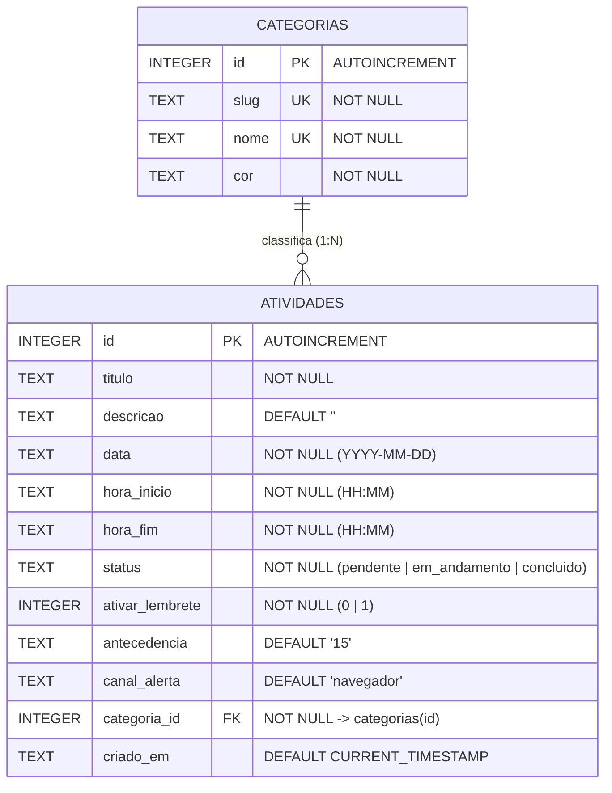

# Documentação Técnica — Etapa 07: Persistência e CRUD com Banco de Dados

**Projeto:** EasySched — Gestão Integrada de Cronogramas e Lembretes  
**Objetivo:** Substituir o armazenamento temporário em memória por persistência real em banco de dados relacional, estruturando entidades relacionadas, validações de integridade, tratamento de erros de persistência e desacoplamento entre a camada HTTP e o acesso aos dados.

---

## 1. Escolha do Banco de Dados e Arquitetura

### 1.1. Justificativa pela Escolha do SQLite (Modelo Relacional)
Para a camada de persistência do **EasySched**, foi adotado um **banco de dados relacional utilizando SQLite** (`sqlite3` com a interface assíncrona `sqlite` no Node.js), pelos seguintes motivos técnicos:

1. **Aderência ao Domínio Estruturado:** As entidades *Categoria* e *Atividade* possuem atributos bem definidos (datas ISO, horários, estados enumerados e flags booleanas) e um vínculo hierárquico direto (`1:N`), beneficiando-se de restrições nativas de esquema (`NOT NULL`, `UNIQUE`, `CHECK` e `FOREIGN KEY`).
2. **Garantia de Integridade Referencial:** O suporte a chaves estrangeiras (`PRAGMA foreign_keys = ON`) impede o cadastro de atividades vinculadas a categorias inexistentes e bloqueia a remoção de categorias que ainda possuam atividades associadas (`ON DELETE RESTRICT`).
3. **Portabilidade e Execução Autocontida:** Como o SQLite persiste toda a base em um único arquivo em disco (`server/database/easysched.db`), a aplicação mantém os dados entre reinicializações sem depender da instalação de servidores externos ou containers para execução local.
4. **Facilidade de Evolução:** Por utilizar SQL padrão isolado em repositórios dedicados, uma eventual migração futura para outro SGBD relacional (como PostgreSQL) exige alterar apenas a camada de persistência, preservando intactas as regras de negócio da API.

---

### 1.2. Arquitetura Desacoplada (Separação de Responsabilidades)
Para evitar acoplamento entre as rotas Express e os comandos SQL, o back-end foi organizado em três camadas distintas:

* **Camada de Infraestrutura (`server/database/`):** Gerencia a abertura da conexão com o SQLite, ativa o controle de chaves estrangeiras e executa o script DDL (`schema.sql`) na inicialização.
* **Camada de Repositórios (`server/repositories/`):** Encapsula exclusivamente as consultas SQL (`SELECT`, `INSERT`, `UPDATE`, `DELETE` e `INNER JOIN`) e converte os registros relacionais (`snake_case`) para os objetos JSON da aplicação (`camelCase`).
* **Camada de Transporte HTTP (`server/routes/` e `server/server.js`):** Recebe as requisições REST, valida os dados de entrada, invoca os repositórios e converte eventuais exceções em códigos de status HTTP padronizados.

```text
EasySched/
├── client/                               # Interface Web (HTML5, CSS3, JS ES6+)
│   ├── principal.html                    # Dashboard e cronograma diário
│   ├── atividade.html                    # Formulário de cadastro e edição
│   ├── relatorio.html                    # Relatórios e indicadores por categoria/status
│   └── js/
│       ├── api.js                        # Cliente HTTP integrado a /api/atividades e /api/categorias
│       ├── principal.js                  # Renderização do painel principal
│       ├── atividade.js                  # Carga dinâmica de categorias e envio do formulário
│       └── relatorio.js                  # Consolidação de horas e métricas
├── server/                               # Back-end Node.js + Express + SQLite
│   ├── database/
│   │   ├── schema.sql                    # Script DDL de criação das tabelas e dados iniciais (seed)
│   │   ├── connection.js                 # Gerenciador de conexão e inicialização do banco
│   │   └── easysched.db                  # Arquivo persistente do SQLite (ignorado no Git)
│   ├── repositories/
│   │   ├── categoriaRepository.js        # Persistência da entidade Categorias
│   │   └── atividadeRepository.js        # Persistência CRUD (com JOIN) da entidade Atividades
│   ├── routes/
│   │   ├── categorias.js                 # Endpoints REST /api/categorias
│   │   └── atividades.js                 # Endpoints REST /api/atividades
│   ├── package.json                      # Dependências (express, cors, sqlite, sqlite3)
│   └── server.js                         # Configuração do servidor e middleware global de erros
└── docs/
    ├── etapa-06.md                       # Documentação da Etapa 06
    ├── etapa-07.md                       # Documentação da Etapa 07 (este arquivo)
    └── requisicoes.http                  # Coleção de testes para REST Client (VS Code)
```

---

## 2. Modelo do Banco de Dados

### 2.1. Diagrama Entidade-Relacionamento (DER)



---

### 2.2. Descrição das Entidades

#### Entidade `categorias`
Armazena as áreas de organização disponíveis para classificar as tarefas e calcular a distribuição de tempo nos relatórios.

| Coluna | Tipo SQL | Restrições | Descrição |
| :--- | :--- | :--- | :--- |
| `id` | `INTEGER` | `PRIMARY KEY AUTOINCREMENT` | Identificador único numérico da categoria. |
| `slug` | `TEXT` | `NOT NULL UNIQUE` | Identificador textual normalizado utilizado pela aplicação (ex: `estudos`, `trabalho`). |
| `nome` | `TEXT` | `NOT NULL UNIQUE` | Rótulo legível exibido na interface (ex: `Estudos`, `Trabalho`). |
| `cor` | `TEXT` | `NOT NULL DEFAULT '#3b82f6'` | Código hexadecimal associado à categoria para exibição visual nos relatórios. |

#### Entidade `atividades`
Armazena os compromissos, tarefas agendadas e configurações de lembrete do usuário.

| Coluna | Tipo SQL | Restrições | Descrição |
| :--- | :--- | :--- | :--- |
| `id` | `INTEGER` | `PRIMARY KEY AUTOINCREMENT` | Identificador único numérico da atividade. |
| `titulo` | `TEXT` | `NOT NULL` | Título resumido da atividade. |
| `descricao` | `TEXT` | `DEFAULT ''` | Detalhamento opcional da tarefa. |
| `data` | `TEXT` | `NOT NULL` | Data agendada no formato ISO (`YYYY-MM-DD`). |
| `hora_inicio` | `TEXT` | `NOT NULL` | Horário de início no formato `HH:MM`. |
| `hora_fim` | `TEXT` | `NOT NULL` | Horário de término no formato `HH:MM`. |
| `status` | `TEXT` | `NOT NULL DEFAULT 'pendente'`, `CHECK` | Estado de execução (`pendente`, `em_andamento` ou `concluido`). |
| `ativar_lembrete` | `INTEGER` | `NOT NULL DEFAULT 0`, `CHECK` | Indicador booleano de alerta (`0` = desativado, `1` = ativado). |
| `antecedencia` | `TEXT` | `DEFAULT '15'` | Tempo de antecedência do lembrete em minutos. |
| `canal_alerta` | `TEXT` | `DEFAULT 'navegador'` | Meio de notificação configurado. |
| `categoria_id` | `INTEGER` | `NOT NULL`, `FOREIGN KEY` | Chave estrangeira que referencia `categorias(id)`. |
| `criado_em` | `TEXT` | `DEFAULT CURRENT_TIMESTAMP` | Data e hora de inserção do registro no banco. |

---

### 2.3. Descrição dos Relacionamentos
* **Relacionamento `categorias` (1) $\rightarrow$ `atividades` (N):** Uma categoria pode estar associada a zero ou muitas atividades, enquanto cada atividade pertence obrigatoriamente a uma única categoria.
* **Implementação Física:** Definida pela coluna `categoria_id` na tabela `atividades` com a restrição `FOREIGN KEY (categoria_id) REFERENCES categorias(id) ON DELETE RESTRICT`.
* **Comportamento de Integridade:**
  * Impede a inserção ou atualização de uma atividade com um `categoria_id` inexistente.
  * Impede a exclusão de uma categoria caso existam atividades vinculadas a ela, preservando a consistência histórica dos dados.

---

## 3. Instruções para Criação e Inicialização do Banco

### 3.1. Inicialização Automática pela Aplicação (Recomendado)
O banco de dados é criado e estruturado automaticamente na primeira execução do servidor Node.js, sem necessidade de ferramentas externas:

1. **Pré-requisito:** Ter o **Node.js (v18+ ou LTS)** instalado.
2. **Instalar as dependências do servidor:**
   ```bash
   cd server
   npm install
   ```
3. **Iniciar o servidor e inicializar o banco:**
   ```bash
   npm start
   ```
   Ao executar `npm start`, o módulo `server/database/connection.js` cria o arquivo `server/database/easysched.db` (caso ainda não exista), ativa `PRAGMA foreign_keys = ON` e executa o script `server/database/schema.sql`, criando as tabelas e inserindo as 4 categorias padrão (`Estudos`, `Trabalho`, `Saúde` e `Lazer`).

---

### 3.2. Script SQL de Criação (`server/database/schema.sql`)
Caso deseje criar ou inspecionar o banco manualmente via CLI do SQLite (`sqlite3 server/database/easysched.db < server/database/schema.sql`), o script completo utilizado pela aplicação é:

```sql
PRAGMA foreign_keys = ON;

CREATE TABLE IF NOT EXISTS categorias (
    id INTEGER PRIMARY KEY AUTOINCREMENT,
    slug TEXT NOT NULL UNIQUE,
    nome TEXT NOT NULL UNIQUE,
    cor TEXT NOT NULL DEFAULT '#3b82f6'
);

CREATE TABLE IF NOT EXISTS atividades (
    id INTEGER PRIMARY KEY AUTOINCREMENT,
    titulo TEXT NOT NULL,
    descricao TEXT DEFAULT '',
    data TEXT NOT NULL,
    hora_inicio TEXT NOT NULL,
    hora_fim TEXT NOT NULL,
    status TEXT NOT NULL DEFAULT 'pendente' CHECK (status IN ('pendente', 'em_andamento', 'concluido')),
    ativar_lembrete INTEGER NOT NULL DEFAULT 0 CHECK (ativar_lembrete IN (0, 1)),
    antecedencia TEXT DEFAULT '15',
    canal_alerta TEXT DEFAULT 'navegador',
    categoria_id INTEGER NOT NULL,
    criado_em TEXT DEFAULT CURRENT_TIMESTAMP,
    FOREIGN KEY (categoria_id) REFERENCES categorias(id) ON DELETE RESTRICT
);

INSERT OR IGNORE INTO categorias (id, slug, nome, cor) VALUES
    (1, 'estudos', 'Estudos', '#2563eb'),
    (2, 'trabalho', 'Trabalho', '#7c3aed'),
    (3, 'saude', 'Saúde', '#16a34a'),
    (4, 'lazer', 'Lazer', '#ea580c');
```

### 3.3. Como Resetar o Banco de Dados
Para limpar todos os registros de teste e recriar o banco zerado:
1. Encerre o servidor (`Ctrl + C` no terminal).
2. Exclua o arquivo `server/database/easysched.db`.
3. Execute `npm start` novamente dentro de `server/`.

---

## 4. Endpoints, Validações e Tratamento de Erros

**Base URL:** `http://localhost:3000/api`

| Método | Endpoint | Operação | Status HTTP |
| :--- | :--- | :--- | :--- |
| `GET` | `/api/categorias` | Lista todas as categorias cadastradas no banco. | `200 OK` |
| `POST` | `/api/categorias` | Cadastra uma nova categoria. | `201 Created`, `400 Bad Request` |
| `GET` | `/api/atividades` | Lista todas as atividades com dados da categoria (`INNER JOIN`). | `200 OK` |
| `GET` | `/api/atividades/:id` | Consulta uma atividade específica pelo `id`. | `200 OK`, `404 Not Found` |
| `POST` | `/api/atividades` | Valida e persiste uma nova atividade no banco. | `201 Created`, `400 Bad Request` |
| `PUT` | `/api/atividades/:id` | Valida e atualiza uma atividade existente no banco. | `200 OK`, `400 Bad Request`, `404 Not Found` |
| `DELETE` | `/api/atividades/:id` | Remove uma atividade persistida pelo `id`. | `200 OK`, `404 Not Found` |

### Validações e Tratamento de Erros de Persistência
* **Validação de Domínio (`400 Bad Request`):** Verifica presença de campos obrigatórios (`titulo`, `data`, `horaInicio`, `horaFim`, `categoriaId`/`categoria`), consistência cronológica (`horaFim > horaInicio`), valores permitidos para `status` e existência prévia da categoria no banco de dados.
* **Integridade do Banco (`400 Bad Request`):** O middleware global captura erros de restrição do SQLite (`err.code === 'SQLITE_CONSTRAINT'`), como tentativa de inserir categoria com `nome` ou `slug` duplicado ou violação de chave estrangeira, retornando resposta estruturada em JSON.
* **Falhas de Infraestrutura (`500 Internal Server Error`):** Erros de leitura/escrita ou bloqueio do banco (`SQLITE_*`) são interceptados, registrados no log do servidor e respondidos de forma segura ao cliente sem expor detalhes internos.

---

## 5. Exemplos de Operações CRUD

### 5.1. Consultar Categorias (`GET /api/categorias`)

**Requisição:**
```http
GET http://localhost:3000/api/categorias
```

**Resposta (`200 OK`):**
```json
[
  {
    "id": 1,
    "slug": "estudos",
    "nome": "Estudos",
    "cor": "#2563eb"
  },
  {
    "id": 2,
    "slug": "trabalho",
    "nome": "Trabalho",
    "cor": "#7c3aed"
  },
  {
    "id": 3,
    "slug": "saude",
    "nome": "Saúde",
    "cor": "#16a34a"
  },
  {
    "id": 4,
    "slug": "lazer",
    "nome": "Lazer",
    "cor": "#ea580c"
  }
]
```

---

### 5.2. Criar Categoria (`POST /api/categorias`)

**Requisição:**
```http
POST http://localhost:3000/api/categorias
Content-Type: application/json

{
  "nome": "Projetos",
  "cor": "#0891b2"
}
```

**Resposta (`201 Created`):**
```json
{
  "id": 5,
  "slug": "projetos",
  "nome": "Projetos",
  "cor": "#0891b2"
}
```

---

### 5.3. Criar Atividade (`POST /api/atividades`)

**Requisição:**
```http
POST http://localhost:3000/api/atividades
Content-Type: application/json

{
  "titulo": "Implementar persistência com SQLite",
  "descricao": "Validar relacionamento 1:N entre categorias e atividades",
  "data": "2026-11-24",
  "horaInicio": "19:00",
  "horaFim": "21:00",
  "categoriaId": 1,
  "status": "pendente",
  "ativarLembrete": true,
  "antecedencia": "30",
  "canalAlerta": "navegador"
}
```

**Resposta (`201 Created`):**
```json
{
  "id": "1",
  "titulo": "Implementar persistência com SQLite",
  "descricao": "Validar relacionamento 1:N entre categorias e atividades",
  "data": "2026-11-24",
  "horaInicio": "19:00",
  "horaFim": "21:00",
  "categoriaId": 1,
  "categoria": "estudos",
  "categoriaRotulo": "Estudos",
  "status": "pendente",
  "statusRotulo": "Pendente",
  "ativarLembrete": true,
  "antecedencia": "30",
  "canalAlerta": "navegador"
}
```

---

### 5.4. Consultar Todas as Atividades (`GET /api/atividades`)

**Requisição:**
```http
GET http://localhost:3000/api/atividades
```

**Resposta (`200 OK`):**
```json
[
  {
    "id": "1",
    "titulo": "Implementar persistência com SQLite",
    "descricao": "Validar relacionamento 1:N entre categorias e atividades",
    "data": "2026-11-24",
    "horaInicio": "19:00",
    "horaFim": "21:00",
    "categoriaId": 1,
    "categoria": "estudos",
    "categoriaRotulo": "Estudos",
    "status": "pendente",
    "statusRotulo": "Pendente",
    "ativarLembrete": true,
    "antecedencia": "30",
    "canalAlerta": "navegador"
  }
]
```

---

### 5.5. Consultar Atividade por ID (`GET /api/atividades/:id`)

**Requisição:**
```http
GET http://localhost:3000/api/atividades/1
```

**Resposta (`200 OK`):**
```json
{
  "id": "1",
  "titulo": "Implementar persistência com SQLite",
  "descricao": "Validar relacionamento 1:N entre categorias e atividades",
  "data": "2026-11-24",
  "horaInicio": "19:00",
  "horaFim": "21:00",
  "categoriaId": 1,
  "categoria": "estudos",
  "categoriaRotulo": "Estudos",
  "status": "pendente",
  "statusRotulo": "Pendente",
  "ativarLembrete": true,
  "antecedencia": "30",
  "canalAlerta": "navegador"
}
```

---

### 5.6. Atualizar Atividade (`PUT /api/atividades/:id`)

**Requisição:**
```http
PUT http://localhost:3000/api/atividades/1
Content-Type: application/json

{
  "titulo": "Implementar persistência com SQLite (Concluída)",
  "descricao": "Banco relacional validado entre reinicializações",
  "data": "2026-11-24",
  "horaInicio": "19:00",
  "horaFim": "21:00",
  "categoriaId": 1,
  "status": "concluido",
  "ativarLembrete": false,
  "antecedencia": "15",
  "canalAlerta": "navegador"
}
```

**Resposta (`200 OK`):**
```json
{
  "id": "1",
  "titulo": "Implementar persistência com SQLite (Concluída)",
  "descricao": "Banco relacional validado entre reinicializações",
  "data": "2026-11-24",
  "horaInicio": "19:00",
  "horaFim": "21:00",
  "categoriaId": 1,
  "categoria": "estudos",
  "categoriaRotulo": "Estudos",
  "status": "concluido",
  "statusRotulo": "Concluído",
  "ativarLembrete": false,
  "antecedencia": "15",
  "canalAlerta": "navegador"
}
```

---

### 5.7. Excluir Atividade (`DELETE /api/atividades/:id`)

**Requisição:**
```http
DELETE http://localhost:3000/api/atividades/1
```

**Resposta (`200 OK`):**
```json
{
  "mensagem": "Atividade excluída com sucesso.",
  "atividade": {
    "id": "1",
    "titulo": "Implementar persistência com SQLite (Concluída)",
    "descricao": "Banco relacional validado entre reinicializações",
    "data": "2026-11-24",
    "horaInicio": "19:00",
    "horaFim": "21:00",
    "categoriaId": 1,
    "categoria": "estudos",
    "categoriaRotulo": "Estudos",
    "status": "concluido",
    "statusRotulo": "Concluído",
    "ativarLembrete": false,
    "antecedencia": "15",
    "canalAlerta": "navegador"
  }
}
```

---

### 5.8. Exemplos de Tratamento de Erros de Validação e Persistência

**Violação de Integridade Referencial (`400 Bad Request` — `categoriaId` inexistente):**
```json
{
  "erro": "Dados inválidos.",
  "detalhes": [
    "A categoriaId informada não existe no banco de dados."
  ]
}
```

**Violação de Restrição Única no SQLite (`400 Bad Request` — `SQLITE_CONSTRAINT` ao duplicar categoria):**
```json
{
  "erro": "Erro de integridade no banco de dados.",
  "detalhes": [
    "Violação de chave única ou chave estrangeira (registro duplicado ou referência inválida)."
  ]
}
```

**Registro Não Encontrado (`404 Not Found`):**
```json
{
  "erro": "Atividade não encontrada."
}
```

---

## 6. Validação da Persistência entre Reinicializações

Para comprovar o funcionamento real em disco e a coleção de testes disponível em `docs/requisicoes.http`:

1. Inicie o servidor (`cd server && npm start`) e cadastre uma atividade via `POST /api/atividades` (ou pela interface web `client/atividade.html`).
2. Encerre completamente o processo do Node.js no terminal (`Ctrl + C`).
3. Inicie o servidor novamente com `npm start`.
4. Execute `GET /api/atividades` (ou abra `client/principal.html` e `client/relatorio.html`): os registros gravados em `server/database/easysched.db` permanecem íntegros após a reinicialização.